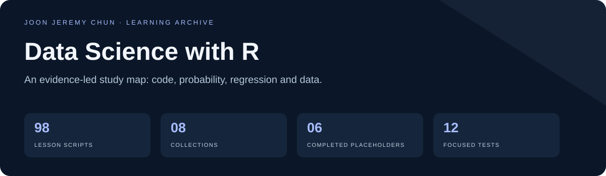
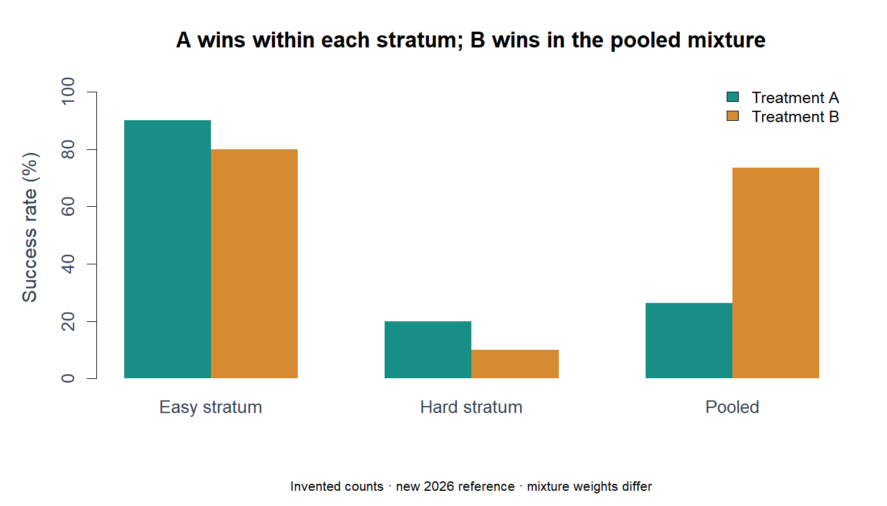

<div align="center">



# Data Science with R

**Learn the computation. Check the assumptions. Explain what the result can support.**

[Study map](#study-map) · [Case studies](#case-studies) · [Source catalog](docs/SOURCE_CATALOG.md) · [Reproduce](docs/REPRODUCIBILITY.md)

</div>

A detailed archive of R data-science coursework and investigations: **98 lesson scripts across eight collections**, plus one explicit dependency helper and an original R Markdown example. Topics connect programming, wrangling, graphics, simulation, regression and supervised learning.

> **Verified maintenance — 2026-10-20:** six former placeholders were completed, a separate offline Iris companion was added, and 40 R paths received reviewed changes. All 85 selected offline lesson checks completed; 12 focused mathematical/behavioral cases passed. Fourteen effectful or large examples remain outside the routine smoke run.

## Study map

| Order | Collection | What to investigate |
|---|---|---|
| 1 | [R programming foundations](R_Basics/README.md) | Move from types and vector indexing to explicit transformations, grouped summaries and reusable functions. |
| 2 | [Visualization and distribution checks](Visualization/README.md) | Understand what axes, scales and quantiles mean before adding plot decoration. |
| 3 | [Probability and simulation](Probability/README.md) | Connect sample spaces, exact probabilities, simulation uncertainty and dependence assumptions. |
| 4 | [Data import, reshaping and text](Data_wrangling/README.md) | Trace how raw files and messy strings become typed, joined and tidy tables. |
| 5 | [Regression, uncertainty and interpretation](Linear_regression/README.md) | Progress from association and least squares to uncertainty, selection and causal interpretation. |
| 6 | [Supervised-learning entry point](Machine_learning/README.md) | Separate conceptual notes from a small reproducible classifier. |
| 7 | [Reproducible work and Git review](Productivity_tools-github/README.md) | Record the software context and inspect changes before publishing. |
| 8 | [Small mathematics and probability investigations](useful_math-statistics_codes/README.md) | Use exact answers to check simulation and computation. |

## Case studies

| Investigation | Key idea |
|---|---|
| [Common causes and adjusted regression](docs/cases/confounding/README.md) | Show how a common cause Z creates an X–Y association even though X has no direct term in the generating equation. |
| [A strict Simpson reversal](docs/cases/simpson/README.md) | Explain how pooling different mixtures can reverse a comparison that holds within every stratum. |
| [Independent versus dependent loan losses](docs/cases/dependent-defaults/README.md) | Hold the marginal default rate fixed and inspect how shared dependence changes aggregate loss uncertainty. |
| [Natural blackjack: simulation and an exact answer](docs/cases/blackjack/README.md) | Use a finite sample space to validate a Monte Carlo estimate. |
| [An offline token-counting reference](docs/cases/text-mining/README.md) | Turn a comment-only text-mining note into a small inspectable operation without downloading a corpus. |
| [An offline Iris classifier in R](docs/cases/iris-classification/README.md) | Make the feature/outcome concepts concrete while keeping test data separate from preprocessing. |
| [Regression scores and a constrained baseball roster](docs/cases/baseball-roster/README.md) | Follow a team-level regression into an illustrative player-scoring and budget-constrained selection problem. |
| [Parsing inconsistent height entries](docs/cases/reported-heights/README.md) | Separate malformed strings, plausible units and numeric ranges before interpreting measurements. |
| [Birthday collisions and boundary-aware formulas](docs/cases/birthday/README.md) | Compare simulation with the complement of all birthdays being unique. |

### A comparison can reverse when groups are pooled

The new Simpson reference uses invented counts: A has the higher success rate in each stratum, while B has the higher pooled rate because the groups have different mixture weights.



*New 2026 reference output. See the [counts, assumptions and verification](docs/cases/simpson/README.md).*

## What was completed or repaired

- **Former placeholders:** confounding, Simpson’s paradox, dependent defaults, natural blackjack, offline text counting and reproducibility/Git practice.
- **Independent execution:** missing imports/setup, resolved package data paths, explicit regex/reshaping preparation and caught pedagogical error demonstrations.
- **Numerical/data correctness:** roster variable alignment, roulette variance/wheel setup, month labels, sum/birthday boundaries and million-dollar plotting units.
- **Explicit preparation:** packages.R now inspects by default and installs only with --install; the PDF exercise no longer opens a viewer automatically.

Full details are in the [repair log](docs/REPAIRS.md). Original examples, datasets, project files and historic numeric comments are preserved. The introduction notes being edited in the original worktree were left unchanged; the new Iris companion is separate.

## Start with a verified example

```bash
Rscript --vanilla "Linear_regression/3.5 Simpson's Paradox.R"
Rscript --vanilla "Machine_learning/2.1 Offline classification reference.R"
Rscript --vanilla tests/test_repairs.R
Rscript --vanilla tools/validate_r_sources.R
python tools/validate_archive.py
```

Use the [reproduction guide](docs/REPRODUCIBILITY.md) for Rscript discovery on Windows, dependency inspection, the offline smoke runner and external-data prerequisites. A successful small check does not reproduce every historical result or validate a causal claim.

## Documentation and evidence

- [Full source catalog](docs/SOURCE_CATALOG.md): all 98 lessons and the package helper.
- [Repairs](docs/REPAIRS.md), [validation](docs/VALIDATION.md), [reproduction](docs/REPRODUCIBILITY.md).
- [Figure sources](assets/readme/SOURCES.md): authored cover and freshly generated synthetic reference plots.
- [Korean handoff](docs/handoffs/HANDOFF_2026-10-20.md) and [shared agent instructions](AGENTS.md).

## Learning sources and attribution

The prior README credits Harvard University’s Professional Certificate in Data Science as inspiration; source notes cite Rafael A. Irizarry. This documents learning material and does not independently verify a credential, original authorship of course examples or project dates.

The [original textbook site](https://rafalab.dfci.harvard.edu/dsbook/) identifies its first edition and links newer editions. Package datasets such as [dslabs](https://cran.r-project.org/package=dslabs), HistData and Lahman retain their own provenance and rights. No new blanket license or current-world policy/financial claim is assigned.
