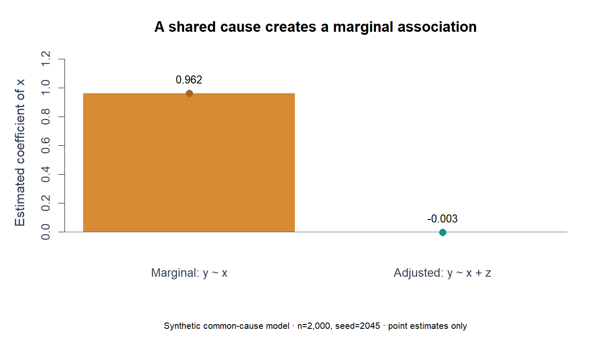

# Common causes and adjusted regression

[← Portfolio](../../../README.md) · [Open source](../../../Linear_regression/3.4%20Confounders%20-%20if%20changes%20in%20Z%20causes%20changes%20in%20both%20X%20and%20Y.R) · [Collection](../../../Linear_regression/README.md)

> Evidence type: new 2026 reference implementation.

## Question

Show how a common cause Z creates an X–Y association even though X has no direct term in the generating equation.

## Data and assumptions

Seed 2045; n=2,000 standard-normal Z values; independent normal disturbances; X=Z+noise and Y=2Z+noise. All observations are synthetic.

## Method

confounding_example() returns the data, lm(y~x) and lm(y~x+z). The marginal coefficient is expected near 1; the adjusted X coefficient near 0. The new plot shows one seeded sample, with no confidence intervals.

## How to inspect it

1. Read the data construction and parameter definitions before the numerical/statistical operation.
2. Trace the function’s returned objects, then compare with the formula or evaluation target described above.
3. Read the focused-test case and the limitations before interpreting a plot or number.

## Evidence and checks

A 20,000-row focused check verifies the expected marginal association, near-zero adjusted X coefficient and Z coefficient near 2.



*Fresh 2026 synthetic reference output from tools/render_reference_figures.R. It does not replace historical course results.*

## Run from the repository root

```bash
Rscript --vanilla "Linear_regression/3.4 Confounders - if changes in Z causes changes in both X and Y.R"
```

The new reference functions can also be sourced and called explicitly. Direct scripts may print tables or display plots; consult the execution matrix for older lessons.

## Limits

This is a constructed example with a known generating mechanism. Adjusting observational data does not automatically identify a causal effect.

For exact repaired paths and validation scope, see [repairs](../../REPAIRS.md) and [validation](../../VALIDATION.md).
