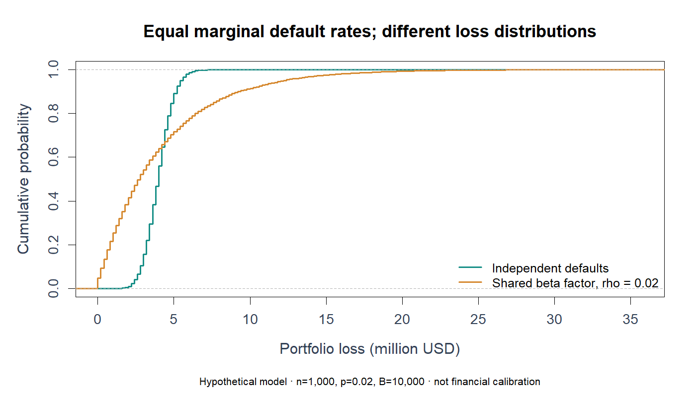

# Independent versus dependent loan losses

[← Portfolio](../../../README.md) · [Open source](../../../Probability/section%204%3B%20independence%20and%20dependence%20of%20sample-the%20big%20short.R) · [Collection](../../../Probability/README.md)

> Evidence type: new 2026 reference implementation.

## Question

Hold the marginal default rate fixed and inspect how shared dependence changes aggregate loss uncertainty.

## Data and assumptions

Hypothetical n=1,000 loans, p=0.02 default probability, positive loss amount 200,000 USD per default and rho=0.02. Default-loss output uses a positive-loss convention; the older independent-interest script uses signed negative losses.

## Method

Independent counts are binomial. The dependent version draws a shared probability from Beta(p*c,(1-p)*c), c=1/rho−1, then draws a conditional binomial count. Mean is n*p*loss; variance is n*p*(1-p)*(1+(n-1)*rho)*loss². rho=0 uses the independent limit.

## How to inspect it

1. Read the data construction and parameter definitions before the numerical/statistical operation.
2. Trace the function’s returned objects, then compare with the formula or evaluation target described above.
3. Read the focused-test case and the limitations before interpreting a plot or number.

## Evidence and checks

Focused cases check simulated means/variances against the stated formulas and the rho=0 boundary. The new CDF figure uses B=10,000, seed 2045.



*Fresh 2026 synthetic reference output from tools/render_reference_figures.R. It does not replace historical course results.*

## Run from the repository root

```bash
Rscript --vanilla "Probability/section 4; independence and dependence of sample-the big short.R"
```

The new reference functions can also be sourced and called explicitly. Direct scripts may print tables or display plots; consult the execution matrix for older lessons.

## Limits

This is a beta-binomial teaching model. It is not a calibrated credit model, an interest-rate recommendation or a forecast of actual portfolio losses.

For exact repaired paths and validation scope, see [repairs](../../REPAIRS.md) and [validation](../../VALIDATION.md).
